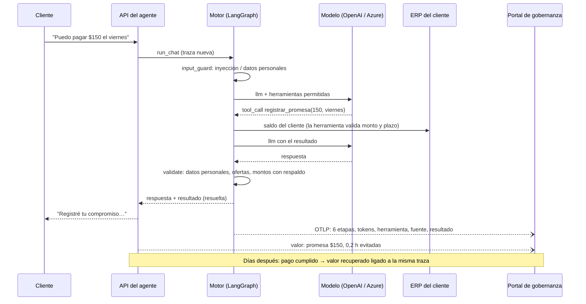

# Arquitectura

## Componentes

| Componente | Tecnología | Responsabilidad |
|---|---|---|
| Consola (`web/`) | React 19, Vite, Tailwind, TanStack Query | Bandeja de aprobación, cartera, simulador de cliente, conversaciones, definición, conocimiento, ajustes |
| API (`agente.api`) | FastAPI | Sesión, casos de uso, publicación de definiciones |
| Motor (`agente.engine`) | LangGraph + langchain-core | Compila la definición a un grafo y lo ejecuta, con un span por nodo |
| Herramientas (`agente.tools`) | Python, Pydantic | Contratos tipados; reglas del negocio |
| Dominio (`agente.domain`) | Python | Priorización de cartera, seguimiento de promesas, adaptador del ERP |
| Base | PostgreSQL 17 | Usuarios, definiciones, conversaciones, aprobaciones, promesas, conocimiento (texto completo), ERP simulado |
| Gobierno (`engine/governance.py`) | plataforma-sdk (OpenTelemetry) | Enrolamiento, manifiesto, trazas, valor, valoración |

## Una conversación, paso a paso

## Datos: qué queda dónde

| Dato | Base del agente (cliente) | Portal |
|---|---|---|
| Texto de las conversaciones | Sí (datos personales ocultos, retención definida) | No |
| Cartera, facturas, nombres | Sí (o en el ERP) | No |
| Etapas, tokens, latencia, herramientas, fuentes | — | Sí |
| Categoría de un control aplicado | Sí | Sí (solo la categoría) |
| Promesas y pagos | Sí (detalle) | Sí (monto por evento, sin persona) |
| Definición del agente | Sí (completa, con instrucciones) | Manifiesto (sin instrucciones ni textos) |
